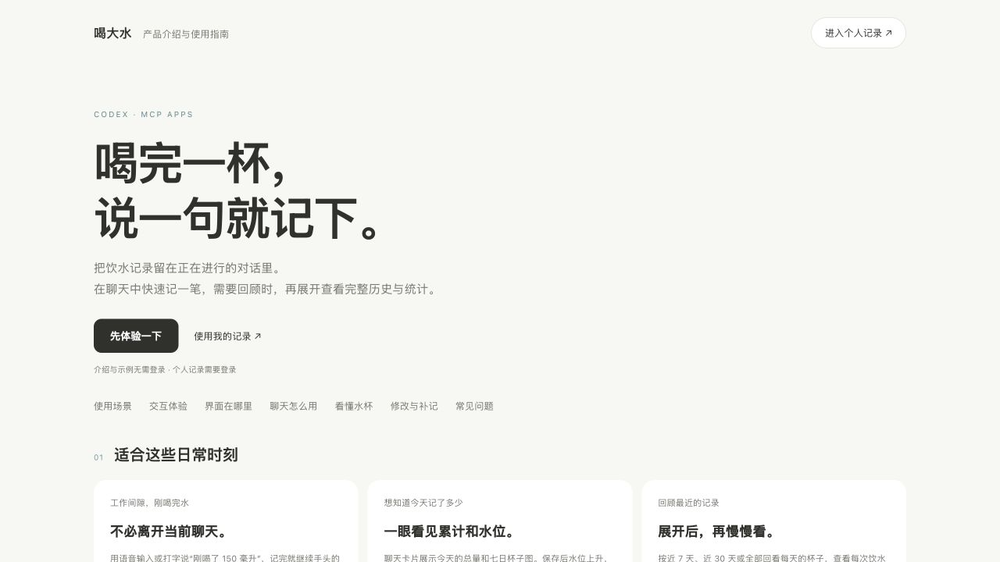

# 喝大水 · He Da Shui

喝完一杯，说一句就记下。一个用 Codex 构建的饮水记录 MCP App：聊天中快速记录，展开后查看全部历史、统计和设置。

A hydration MCP App for quick logging in chat, with daily cup visualizations, history and statistics in the expanded view.

**[产品介绍与可交互示例](https://he-da-shui-daily.zzybread.chatgpt.site/guide)** · **[个人记录网页](https://he-da-shui-daily.zzybread.chatgpt.site/)** · [开发说明](CONTRIBUTING.md) · [MIT License](LICENSE)



## 怎么用

- 连接插件后，在聊天中说“刚喝了 150 毫升”，直接记录并展示结果；说“展示喝大水”只查看。
- 聊天卡片使用加减选量，点“喝了 N ml”保存；支持水位动画、达标反馈和短时撤销。
- 展开卡片，或打开个人记录网页，查看近 7 天、近 30 天或全部日期的杯子、趋势和累计统计。
- “全部历史”支持修改时间/数量、删除误记；“设置”可调整每日目标。按北京时间划分日期。

公开介绍页无需登录，示例全部使用独立模拟数据；个人记录需登录并按账号隔离。默认目标 2000 ml 可自行调整；灰杯表示未记录，不推断当天没有喝水。

聊天功能需要在支持 MCP Apps 的宿主中连接插件。卡片位置、展开方式和语音输入由宿主提供；浏览本介绍页不会自动安装插件。早晨提醒依赖用户单独配置的 Codex 调度，不会自动替用户新增记录。

## 本地运行

需要 Node.js **22.13+**、npm 和 Python 3（集成测试）。

```sh
git clone https://github.com/zzy2002/he-da-shui.git
cd he-da-shui
npm run install:ci
npm run build
```

首次运行时，按顺序初始化**本地** D1 数据库：

```sh
for migration in drizzle/[0-9]*.sql; do
  node --import ./scripts/sites-env.mjs ./node_modules/wrangler/bin/wrangler.js \
    d1 execute DB --local --config dist/server/wrangler.json \
    --persist-to .wrangler/state --file "$migration"
done
npm run dev -- --host 127.0.0.1 --port 3187
```

以上迁移命令用于首次初始化，已有数据库不要重复执行。迁移包含已移除好友功能的历史变更，应按顺序保留。

打开终端打印的本地地址：

| 页面 / 入口 | 用途 |
| --- | --- |
| `/guide` | 产品介绍、使用场景、可操作示例、各界面入口说明 |
| `/` | 完整个人视图：概览、全部历史、设置 |
| `/?view=compact` | 紧凑卡片预览 |
| `/mcp` | MCP JSON-RPC 服务，供宿主连接 |

开发服务模拟本地登录，数据保存在 `.wrangler/state`。这不是生产身份验证；本地数据不会提交到 GitHub 或上传到现有站点。

## 检查与测试

```sh
npm run check:public
npm test
npm run typecheck
npm run build
```

接口集成测试使用无模拟登录的已构建 Worker：先 `npm start -- --port 3188`，再在另一终端执行 `python3 tests/integration.py`。仅允许 loopback 地址，使用独立测试身份验证记录、幂等、隔离、历史分页和 MCP，不操作生产用户记录。

## 结构与技术

React + Vinext、TypeScript、Cloudflare D1 / Drizzle、MCP Apps bridge。

| 目录 | 内容 |
| --- | --- |
| `components/hydration-app.tsx` | 快捷卡片、水杯图、记录反馈 |
| `components/details-app.tsx` | 完整历史、统计与设置 |
| `components/guide-demo.tsx` | 独立示例数据，复用真实组件 |
| `app/guide/` | 公开产品介绍与使用指南 |
| `app/mcp/`、`lib/tools.ts` | MCP 工具与 UI 资源声明 |
| `lib/service.ts`、`lib/history-service.ts` | 按账号隔离的业务逻辑 |
| `db/`、`drizzle/` | 数据模型和迁移，不包含数据库数据 |
| `tests/` | 日期、统计、日历及接口验证 |

MCP 工具：`hydration_read_week`、`hydration_add`、`hydration_update`、`hydration_delete`、`hydration_set_goal`、`hydration_read_history`、`hydration_read_statistics`、`hydration_open`、`hydration_open_details`。新增通过 `requestId` 保证同一请求重试不会重复计入。聊天卡片与完整视图共用组件和业务服务。

更多设计与接口细节见 [架构说明](docs/architecture.md)。

## 持续维护与部署

GitHub 是公开源码与版本历史的保存位置。本地用于开发，网站运行在云端。维护者每次完成修改后执行检查、审阅并提交，再用 `npm run sync:github` 验证并推送到本仓库。该命令不会自动提交、强推或上传未提交文件；Fork 贡献者正常推送自己的分支并发起 PR。

网站部署由 Sites 管理，GitHub push 不会直接更新线上网站。Fork 后发布自己的站点时，需要在 Sites 创建自己的项目并替换 `.openai/hosting.json` 中的 `project_id`；该值是原站点标识，不是凭证，也不提供发布权限。

若改为其他平台托管，需自行配置 D1 和可信认证。当前生产身份依赖 Sites，不能直接信任任意客户端传来的身份请求头。详见 [安全说明](SECURITY.md)。

## 贡献与许可

欢迎通过 Issues 和 PR 改进体验，参见 [CONTRIBUTING.md](CONTRIBUTING.md)。安全问题请按 [SECURITY.md](SECURITY.md) 私密报告。

自有代码使用 [MIT License](LICENSE)，第三方许可见 [THIRD_PARTY_NOTICES.md](THIRD_PARTY_NOTICES.md)。本项目为个人社区项目。
